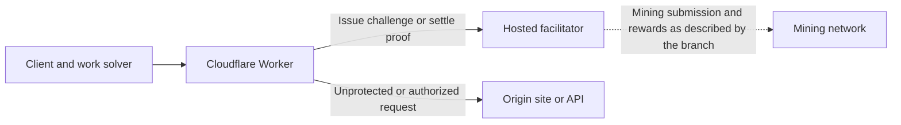

# x402 Work Proxy Design Review

**Status:** Draft for review

**Implementation:** `alan/add-proxy` at `00f6ad517bbfb442d1714cb024d905297113df80`

**Scope:** The Worker implementation and tests in Alan's branch. Facilitator and mining client internals are external dependencies.

The proxy lets a site operator require computation before serving selected routes. It runs as a Cloudflare Worker, obtains mining challenges from a hosted facilitator, and forwards requests after the facilitator accepts a solution. With access cookies enabled, one accepted solution buys a period of access across all protected routes on the host.

The central review decisions are what one payment should unlock, how much trust to place in the facilitator, and what happens when payment succeeds but content delivery fails. The sections below describe the implementation; the final section collects unresolved design questions.

The implementation description remains pinned to Alan's original commit. The local branch `test/proxy-design` adds tests and fixes described under **Testing changes** below.

## Purpose and scope

The branch targets agents, crawlers, and scripts that can answer an HTTP `402 Payment Required` response by solving a mining challenge. Buyers need no account or wallet. Operators supply a payout address, an upstream site or API, and the paths to protect.

The intended economic model uses useful mining work as the access cost. According to the branch's README, solutions meeting network difficulty can earn block rewards for the operator. **Accepted access payments do not each guarantee a payout.** Reward submission, network acceptance, and the relationship between work and expected earnings depend on the external facilitator and network; this repository implements access control around that service.

Included behavior covers route matching, challenge issuance, settlement calls, upstream forwarding, optional access cookies, a configuration health endpoint, and a demo route. The branch also adds Wrangler configuration and development tooling. Browser mining, per-user accounts, per-route prices, request quotas, and a local verifier or payment database are outside the implementation. [Sources: README][readme], [Worker][worker], [seller adapter][seller].

## Architecture and trust boundaries

| Component | Responsibility and trust |
| --- | --- |
| Client | Solves work, retries with a proof, and retains the access cookie if it wants repeat access. The Worker treats proofs and cookies as untrusted inputs. |
| Worker | Chooses protected paths, sends configured terms to the facilitator, checks cookies, and controls forwarding. It holds the optional cookie signing secret. |
| Facilitator | Issues work, decides whether a proof is acceptable, and is expected to prevent spending the same work twice. The Worker trusts its settlement response. |
| Origin | Serves the actual content or API response. The Worker removes its payment signature and access cookie before forwarding. |

The Worker stores configuration and uses a signing secret, but keeps no application database of challenges, spent proofs, or sessions. Replay prevention for proofs belongs to the facilitator. Cookie validation is local and does not contact it. A usable cookie therefore permits access during a facilitator outage. [Sources: Worker][worker], [seller adapter][seller], [access tokens][access].

## Request flow

1. **Handle health checks.** `/__x402/health` is processed before route protection, even when the configured pattern is `*`.
2. **Determine protection.** `/__x402/protected` is always gated. Other paths use the configured patterns. Unprotected requests proceed directly to the origin.
3. **Check existing access.** A valid access cookie for the Worker's host bypasses payment and proceeds to content delivery.
4. **Issue a challenge if no proof is supplied.** The Worker calls the facilitator's requirements endpoint and returns `402` with its `PAYMENT-REQUIRED` header. Clients requesting HTML receive an explanation page; others receive JSON. The page has instructions but no browser solver.
5. **Settle a supplied proof.** The Worker sends `PAYMENT-SIGNATURE` to the facilitator. A rejected proof leads to a fresh challenge. An accepted proof permits content delivery.
6. **Return content and access credentials.** The Worker forwards the request or serves the demo response, adds `PAYMENT-RESPONSE`, and optionally appends an access cookie.

**Example:** With `/premium/*,/report` protected and a one-hour cookie lifetime, a client pays for `/premium/data?day=1`. If it retains the returned cookie, it can then request `/report` and other protected routes on the same host without more work until expiry. [Sources: Worker][worker], [cross-route cookie test][tests].

## Access and pricing semantics

There is one configured price and mining profile for the whole deployment. `PRICE` is a positive integer representing expected guesses. The default is `4096`; the code does not convert it to currency or measure how long a buyer takes to solve it.

The resource URL sent for both challenge issuance and settlement consists of the incoming URL's **scheme, host, and path**. It excludes the query string. HTTP method and request body are also absent from the resource identity. The Worker delegates enforcement of this binding to the facilitator.

Access cookies have broader scope than the original proof. The `x402_work_access` cookie contains an HS256 JWT with host audience, issue time, and expiry. Its attributes are `Path=/; HttpOnly; Secure; SameSite=Lax`. Validation checks the signature, host audience, and expiry; it does not bind access to a route, client identity, IP address, price, or profile.

The default access period is 3,600 seconds when a sufficiently long secret is configured. A missing or shorter-than-32-character `JWT_SECRET` disables cookie acceptance and issuance. `ACCESS_SECONDS=0` disables **issuance of new cookies**, but the current code still accepts an existing unexpired cookie signed with the same secret. Changing price or route configuration also does not invalidate existing cookies. [Sources: Worker][worker], [access tokens][access].

## Configuration and routing

| Setting | Default | Implemented meaning |
| --- | --- | --- |
| `PAY_TO` | Zero-address placeholder in Wrangler | Must be replaced. Local validation checks address format and rejects the QUAI zero address. |
| `PRICE` | `4096` | Positive integer string in expected guesses. Supported ranges depend on the facilitator. |
| `PROFILE` | `quai/sha256d-v1` | Also documents `monero/randomx-v1`, which selects Monero address validation. |
| `PROTECTED_PATTERNS` | Empty | Comma-separated exact paths, prefixes ending in `/*`, or `*`. |
| `ORIGIN_URL` | Unset | Upstream base URL for normal content delivery. |
| `ACCESS_SECONDS` | `3600` | Lifetime for new access cookies; `0` disables issuance. Invalid or negative values fall back to `3600`. |
| `FACILITATOR_URL` | `https://x402.qu.ai` | Override for the external facilitator. |
| `JWT_SECRET` | Unset | Secret of at least 32 characters enabling signed access cookies. |

Blank configuration values fall back to defaults after trimming, except that the signing secret is evaluated by its original length. `/premium/*` matches `/premium` and descendants such as `/premium/a`, but not `/premiumx`. Matching uses the path, independently of method and query parameters. No user routes are protected by default.

For forwarding, the incoming path and query are resolved against `ORIGIN_URL`; its path is not an added prefix. The original method and body are passed through, other request cookies remain, and redirects are returned to the client without being followed. A target with the same host as the Worker is rejected with `508`.

`/__x402/protected` always serves built-in demo JSON after authorization, even if an origin is configured. `/__x402/health` reports local settings and basic payout/price validation. It does **not** check facilitator connectivity, origin availability, address shard validity, or whether a profile is supported remotely. [Sources: Worker][worker], [Wrangler configuration][wrangler], [seller validation][seller].

## Facilitator contract

| Operation | Request sent by the Worker | Response fields used |
| --- | --- | --- |
| `POST /v1/facilitator/requirements` | `payTo`, `amount`, `profile`, and `resource` containing URL and description | `paymentRequired` and `paymentRequiredHeader` |
| `POST /v1/facilitator/settle` | `paymentSignature`, `payTo`, `amount`, and `resource` | `success`, `errorReason`, and `paymentResponseHeader` |

Each fetch to the facilitator uses a 20-second abort timeout. The adapter does not retry automatically. A rejected settlement can trigger a second call to obtain a replacement challenge. The settlement request omits an explicit profile, so correct profile enforcement depends on the facilitator's interpretation of the proof and terms.

The adapter parses responses as JSON but does not validate their schema. A successful HTTP response is trusted to carry the expected challenge or settlement fields. [Source: seller adapter][seller].

## Failure behavior and delivery guarantees

| Condition | Current behavior |
| --- | --- |
| Protected request with no proof or usable cookie | `402` and a challenge, if the facilitator can issue one. |
| Rejected proof or settlement error classified as an invalid request | Fetch a fresh challenge; return `402` with a reason in the JSON body. The HTML page remains generic. |
| Invalid local payout address or price | `500` on the payment path; health also reports the local validation error. |
| Facilitator rate limit | `429` with `Retry-After`. |
| Facilitator network failure, timeout, or HTTP server error | `503` with `Retry-After`; the request is not forwarded. |
| Facilitator refuses requirements with a nonretryable client error | `502` without `Retry-After`. |
| No origin configured | Normal content delivery returns `404`; the protected demo can still work. |
| Origin returns an HTTP error after successful settlement | Preserve that response's status and body, then add the payment receipt and optional cookie. |
| Origin fetch throws after successful settlement | The exception propagates; no receipt or new cookie is returned by this handler. |

**Settlement precedes content delivery.** There is no refund, rollback, or durable delivery record. Work can be consumed even if the origin returns an error, is misconfigured, or cannot be reached.

Likewise, a settlement timeout does not establish whether the facilitator accepted the proof before the response was lost. Although the adapter's network-error message says “Nothing was charged,” it has no reconciliation step to confirm that claim.

The adapter intends to use the facilitator's `Retry-After` header, a JSON fallback, or a default. In the current implementation, an absent header is converted from `null` to `0`, so some errors return `Retry-After: 0`. [Sources: Worker][worker], [seller adapter][seller].

## Validation in the branch

The Bun test suite mocks both facilitator and origin fetches. It covers path matching, local health validation, blank defaults, header and cookie stripping, origin query forwarding, missing origin, direct proxy loops, challenge issuance, the HTML payment page, successful settlement, access across routes, rejected proofs, facilitator errors, and cookie signature, host, and expiry checks.

These tests establish intended local behavior with controlled responses. They do not establish compatibility with a live facilitator or client, real replay prevention, mining payouts, or Cloudflare deployment behavior. Origin failures after settlement, existing cookies after disabling issuance, response caching, and malformed facilitator responses are not covered by the supplied suite. [Source: tests][tests].

## Testing changes

The local branch `test/proxy-design` expands the original 16 tests to 68 tests and corrects four behaviors:

- `ACCESS_SECONDS=0` now ignores existing cookies as well as disabling new ones, matching the documented instruction to charge every request.
- Missing or invalid retry delays now use a valid JSON delay or the Worker's 30-second default. An explicit delay of zero remains valid.
- Malformed facilitator response envelopes, nonboolean settlement outcomes, and missing payment headers now produce `502` without granting access. HTTP errors with malformed bodies retain their status classification.
- Lost settlement responses now report an unknown outcome instead of claiming that no work was charged. This improves the error message; it does not add payment reconciliation.

The tests preserve the existing host-wide access policy and characterize origin delivery failures after settlement. The open decisions below remain relevant; the historical cookie and response-validation behavior described above has the specific fixes listed here. See [Testing the proxy](testing.md) for the test map and commands.

## Questions for design review

| Question | Current behavior and decision to make |
| --- | --- |
| What should one payment buy? | One shared price buys unlimited requests across all protected routes for the cookie lifetime. Confirm whether access should instead be per route, per request, or subject to quotas. |
| How should policy changes affect existing access? | Existing cookies survive changes to price, patterns, and access duration, including setting duration to zero. Decide whether immediate invalidation or a policy version is needed. |
| What happens when paid delivery fails? | Settlement happens first, with no recovery record or rollback. Define the buyer's retry or access-recovery behavior after origin failures and ambiguous settlement timeouts. |
| What identifies the purchased resource? | Query, method, and body do not distinguish payment terms. Confirm whether a shared route price is appropriate for endpoints whose cost or behavior varies across those inputs. |
| How is the origin restricted to authorized traffic? | The Worker gates traffic passing through it. This branch adds no origin authentication or access restriction to prevent direct requests that bypass the Worker. |
| What is the response caching policy? | Worker-generated JSON and payment pages use `no-store`, but paid origin responses retain origin cache headers. Confirm the policy for shared caches and for serving protected responses alongside cookies. |
| What must the facilitator guarantee? | Proof binding, replay protection, profile enforcement, and reward handling are external responsibilities. Define the required contract, response validation, and integration tests, including settlement retry semantics. |
| What operational behavior is required? | Health checks validate only local configuration, and Wrangler enables observability without a payment-specific audit trail. Decide how to monitor challenge failures, settlement outcomes, origin delivery failures, and payout expectations. |

These questions follow from the implemented behavior and its deployment dependencies. They are review topics rather than decisions already made by the branch.

[readme]: https://github.com/0xalank/x402-work-proxy/blob/00f6ad517bbfb442d1714cb024d905297113df80/README.md
[worker]: https://github.com/0xalank/x402-work-proxy/blob/00f6ad517bbfb442d1714cb024d905297113df80/src/index.ts
[seller]: https://github.com/0xalank/x402-work-proxy/blob/00f6ad517bbfb442d1714cb024d905297113df80/src/seller.ts
[access]: https://github.com/0xalank/x402-work-proxy/blob/00f6ad517bbfb442d1714cb024d905297113df80/src/access.ts
[tests]: https://github.com/0xalank/x402-work-proxy/blob/00f6ad517bbfb442d1714cb024d905297113df80/test/proxy.test.ts
[wrangler]: https://github.com/0xalank/x402-work-proxy/blob/00f6ad517bbfb442d1714cb024d905297113df80/wrangler.jsonc
